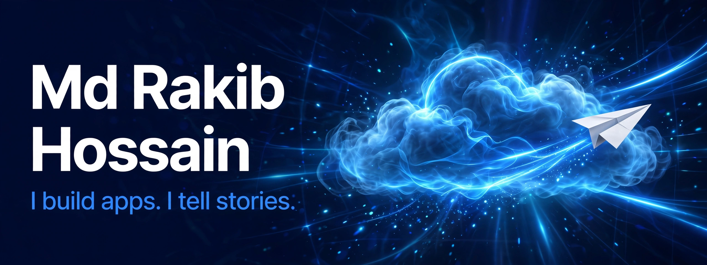

<p align="center">
  <a href="https://www.facebook.com/itsrakiblxp"></a>
  <a href="https://wa.me/+8801920363264"></a>
  <a href="https://github.com/mdrakibhossainkst/nexa-tg-drive"></a>
</p>

<p align="center">
  <b>Bangladesh</b> · <b>বাংলা</b> · <b>English</b><br />
  <i>আমি বাংলায় ভাবি, ইংরেজিতে বানাই।</i>
</p>

```ts
const rakib = {
  from: "Bangladesh",
  speaks: ["বাংলা", "English"],
  does: "Builds apps. Tells stories. Fixes what breaks.",
  currently: "Nexa TG Drive",
  rule: "No ads. No paywall. Every feature free.",
};
```

---

## 🚀 Now building

<table>
  <tr>
    <td width="130" align="center">
      <a href="https://github.com/mdrakibhossainkst/nexa-tg-drive">
        
      </a>
    </td>
    <td>
      <h3><a href="https://github.com/mdrakibhossainkst/nexa-tg-drive">Nexa TG Drive</a></h3>
      <p><i>Your Telegram account, as a personal cloud drive.</i></p>
      <p>Saved Messages is home. Channels are folders. Upload, download, preview and stream — on Windows, macOS and Android.</p>
      <p>
        
        
        
        
      </p>
      <p><a href="https://github.com/mdrakibhossainkst/nexa-tg-drive"><b>See the project →</b></a></p>
    </td>
  </tr>
</table>

---

## 🧭 How I build

| | | |
| :---: | :---: | :---: |
| **🎯 One thing, properly** | **🆓 Free means free** | **🔧 If it breaks, I fix it** |
| I don't ship ten half-finished ideas. I pick one product and keep polishing it until it feels right. | No ads, no paywall, no locked features. If it's in the app, it's for everyone. | Tell me what went wrong — what you clicked, what it said — and I'll get to it. |

---

## 🎬 Beyond code

I also make **Bangla story videos** — short stories, told simply, in my own voice.

Code is one way I tell a story. Video is the other.

---

## 🛠️ What I build with

<p>
  
  
  
  
  
  
</p>

---

## 📊 On GitHub

<p align="center">
  
  
</p>

---

<p align="center">
  <a href="https://www.facebook.com/itsrakiblxp"><b>Facebook</b></a> · <a href="https://wa.me/+8801920363264"><b>WhatsApp</b></a><br />
  <i>Have an idea, a bug, or just want to say hi? I reply faster on WhatsApp.</i>
</p>

<p align="center"><i>— Rakib</i></p>
